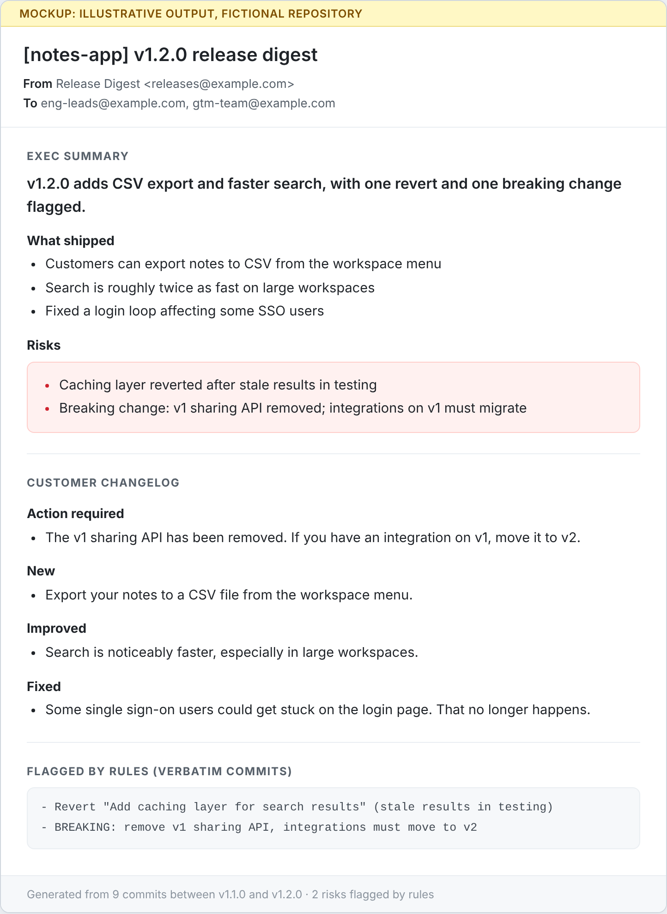
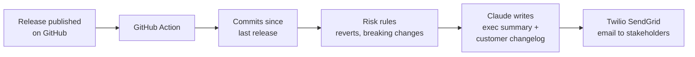

# Release Digest

**Concept: every software release, summarized by AI and emailed to the people who need it.**

As a TPM at Twilio, I've seen product, engineering, and GTM teams quickly lose alignment on the latest releases and what they mean for the program and the business. Release Digest is designed to close that gap by turning every release into an exec summary and a customer changelog, delivered to stakeholders by email.


> **Status: concept and design prototype.** This repo explains the idea, the design, and the expected output. The code in [`prototype/`](prototype/) is a reference sketch and has not been deployed. The output shown is a mockup built from a fictional repository.



## The problem

GitHub notifications are built for developers: one message per event, in engineering language. The people who need to *act* on a release get either nothing or a raw list of commits:
- Leaders need to know what shipped, why it matters, and what's at risk.
- GTM teams and customers need to know what changed for them.

So someone, often a program manager, rewrites the same changes by hand for each audience, every release. It is slow and inconsistent, and risks like a revert or a breaking change are easy to bury in a long list.

**How this differs from GitHub's auto-generated release notes:** those list merged PRs grouped by label, for developers. Release Digest writes for leaders and customers, calls out risks, and delivers the update by email instead of waiting for people to visit the release page.

## The idea

When a release is published on Github, a GitHub Action:
1. Collects the commits since the previous release.
2. Flags risks with simple rules: reverts and breaking changes.
3. Asks Claude to write two versions of the same update: an **exec summary** and a **customer changelog**.
4. Emails both, plus the rule-flagged commits verbatim, through **Twilio SendGrid**.



See the [step-by-step walkthrough](docs/walkthrough.md) for the input, prompt, and output of one release.

## Who it's for

- **Engineering and business leaders** get the exec summary: what shipped, why it matters, and what's at risk.
- **GTM and support teams** get customer-ready changelog text they can forward or post. In v1 both go to one internal list; sending directly to customers comes later, after a human review step.
- **Maintainers** do nothing extra. It runs on release.

## Key design decisions

| Decision | Why |
|---|---|
| **Risks are found by rules, not the model** | The AI explains each risk, and the flagged commits are also appended to the email verbatim by code. If the model misses one, readers still see it. |
| **One input, two audiences** | The same release is written two ways. Rewriting it for each audience is the real manual cost today. |
| **Runs inside GitHub Actions** | No servers, no database, no new tool for maintainers to adopt. Setup is 3 secrets and 1 variable. |
| **Commits, not PRs, as input** | Works for any repo, including ones that don't use PRs or labels consistently. |
| **Email first** | Stakeholders already live in email. Slack and voice can follow. |

## Security and operations

- **Least privilege:** the workflow's GitHub token is read-only (`contents: read`).
- **No credentials in code or logs:** API keys and recipient addresses are GitHub Actions secrets, masked in logs. Actions logs on public repos are public, so the script never prints recipients.
- **No shell injection:** the release tag and other inputs reach the script through environment variables, not string interpolation in the shell command.
- **Fails safely:** missing configuration stops the run with a clear message; API errors report the HTTP status without echoing headers or keys.
- **One digest per release:** a concurrency group prevents duplicate emails, and prereleases are skipped.

## Success metrics

| Goal | Metric | Target |
|---|---|---|
| Remove manual drafting | Who writes the release update | A person reviews it instead of writing it |
| Faster stakeholder updates | Time from release published to update in inboxes | Under 5 minutes |
| Never hide a risk | Rule-flagged commits that appear in the email | 100% (guaranteed by code) |
| Keep it readable | Exec summary length | Under 150 words |
| Reach every release | Releases with a digest sent | 100% |

## Phased plan

| Phase | Scope |
|---|---|
| **v0 Concept** (this repo) | Problem, design, walkthrough, mockup, reference sketch |
| **v1 MVP** | Deploy the Action on a live repo and validate output quality against hand-written updates |
| **v2 Audiences** | Separate emails per audience, changelog written into GitHub Release notes, Slack output |
| **v3 Voice** | Twilio calls a stakeholder on release and reads a 30-second exec summary. Press 1 to acknowledge. |

## Risks and open questions

- **Commit message quality:** vague messages produce vague summaries. Could pull PR descriptions as extra context.
- **Hallucination:** the prompt forbids invented details, but customer-facing text may need a human approval step before sending.
- **Rule coverage:** keyword rules catch obvious risks only. Labels and failing CI checks are natural next signals.
- **Data sensitivity:** commit messages go to an LLM API. Private repos need a review of data handling.
- **Prompt injection:** commit messages are untrusted text. The prompt treats them as data, and the human review step before customer sends is the real safeguard.
- **False positives:** a keyword rule flags "Fix breaking test" as a risk. Acceptable for v1, since an extra flag is cheaper than a missed one.

## Repo contents

| Path | What it is |
|---|---|
| [`docs/walkthrough.md`](docs/walkthrough.md) | One release traced from trigger to email |
| [`docs/email-mockup.png`](docs/email-mockup.png) | Mockup of the email stakeholders receive |
| [`prototype/digest.py`](prototype/digest.py) | Reference sketch: about 90 lines of Python, standard library only |
| [`prototype/test_digest.py`](prototype/test_digest.py) | Tests for the risk rules and prompt (no API keys needed) |
| [`prototype/workflow/release-digest.yml`](prototype/workflow/release-digest.yml) | Reference GitHub Actions workflow (kept outside `.github/` so it doesn't run) |

## Run the tests

Requires Python 3.9+. No dependencies to install. From the repo root:

```bash
python3 -m unittest prototype/test_digest.py -v
```

## Stack

GitHub Actions, Python, Claude API (Anthropic), Twilio SendGrid.

## License

Copyright (c) 2026 Ben Irizarry. All rights reserved. Shared for portfolio and review purposes only; see [LICENSE](LICENSE).
